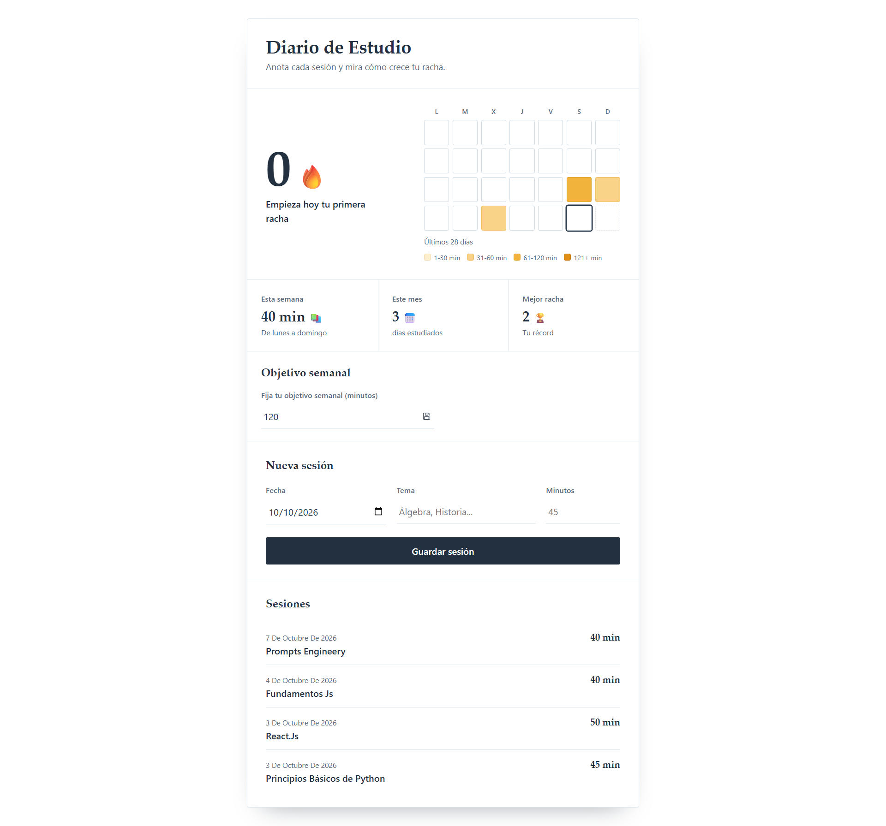

# Diario de Estudio

Web estática para registrar sesiones de estudio y motivarte viendo la racha de días seguidos. Es un proyecto didáctico: el código está pensado para que lo entienda alguien que empieza a programar. También es un experimento de desarrollo con agentes de IA (ver [Cómo se construyó](#cómo-se-construyó)).



## Funcionalidades

- Registrar sesiones de estudio (fecha, tema y minutos).
- Racha de días seguidos y mejor racha alcanzada.
- Mapa de calor de la actividad.
- Objetivo semanal con histórico.

## Uso

No hace falta servidor ni instalar nada: abre `index.html` con doble clic (`file://`).

Los datos se guardan en el `localStorage` del navegador, en tres claves:

- `diario-estudio-sesiones`: las sesiones (fecha, tema, minutos).
- `diario-estudio-mejor-racha`: la mejor racha alcanzada.
- `diario-estudio-objetivos`: el histórico de objetivos semanales.

Para empezar de cero: DevTools → Application → Local Storage → borra esas tres claves.

### Limitaciones conocidas

- Los datos viven solo en el navegador donde los registras: no se sincronizan entre dispositivos ni navegadores.
- Si borras los datos del sitio en el navegador, pierdes tu historial.

## Stack y estructura

HTML, CSS y JavaScript puros: sin frameworks, sin dependencias, sin npm ni build.

```
.
├── index.html          # Estructura de la página
├── styles.css          # Estilos
├── app.js              # Interfaz y manejo de datos
├── goals.js            # Lógica pura del objetivo semanal
├── stats.js            # Lógica pura del mapa de calor
├── tests/              # Pruebas con node --test
├── assets/             # Imágenes
├── docs/
│   └── constitution.md # Principios innegociables del proyecto
├── specs/              # Especificaciones (una carpeta por spec)
├── .opencode/commands/ # Comandos SDD para los agentes
├── AGENTS.md           # Reglas del proyecto para los agentes
└── MEMORY.md           # Memoria entre sesiones
```

## Tests

Requiere Node.js 18 o superior.

```bash
node --test
```

Todos los tests deben pasar antes de cerrar cualquier tarea.

## Cómo se construyó

Este proyecto se desarrolla con **Spec-Driven Development (SDD)**: la spec manda sobre el código. El trabajo lo reparten varios agentes en [opencode](https://opencode.ai), y el desarrollador (humano) aprueba cada fase antes de avanzar.

### Flujo SDD

1. **Constitución:** principios innegociables del proyecto.
2. **Spec:** qué se va a construir y por qué.
3. **Clarificación (QA):** revisión de la spec antes de aprobarla.
4. **Plan:** cómo se va a construir.
5. **Tareas:** el plan dividido en pasos pequeños.
6. **Implementación:** una tarea a la vez, con tests primero.
7. **Validación:** revisión requisito por requisito (RF por RF).
8. **Cierre.**

Cada spec vive en `specs/NNN-nombre/` con `spec.md`, `plan.md` y `tasks.md`.

### Agentes y roles

| Agente | Responsabilidad | No hace |
|---|---|---|
| **Coordinador** | Dirige el flujo, reparte el trabajo, verifica con el navegador y habla con el desarrollador | Escribir código |
| **@planner** | Redacta specs, planes y tareas | Tocar código |
| **@reviewer** | QA: revisa la spec antes de aprobarla y valida la implementación RF por RF | Modificar nada (solo detecta) |
| **@implementer** | Implementa una tarea cada vez, tests primero, con `node --test` en verde antes de seguir | Avanzar sin tests en verde |

Los comandos SDD están en `.opencode/commands/` y se apoyan en la skill `sdd`. La memoria entre sesiones vive en `MEMORY.md` y las reglas del proyecto en `AGENTS.md`.

<!-- Opcional: lista aquí 2 o 3 comandos con una línea cada uno para que el flujo sea reproducible. -->

### MCP y skills instalados

Además de los agentes, el proyecto usa un servidor MCP y varias skills para que los agentes trabajen con más contexto.

**MCP: [`chrome-devtools-mcp`](https://github.com/ChromeDevTools/chrome-devtools-mcp)**

Permite a los agentes abrir y controlar un Chrome real: inspeccionar el DOM, leer la consola, revisar la red y tomar capturas. Es lo que permite al Coordinador verificar la interfaz en el navegador, en vez de dar por buena una tarea solo porque los tests pasan.

Configuración en `opencode.json`:

```json
{
  "mcp": {
    "chrome-devtools": {
      "type": "local",
      "command": ["npx", "-y", "chrome-devtools-mcp@latest"]
    }
  }
}
```

**Skills** (instaladas desde [skills.sh](https://www.skills.sh/)):

| Skill | Para qué sirve | Instalación |
|---|---|---|
| Colección `agent-skills` (Vercel Labs) | Conjunto de skills generales para agentes | `npx skills add vercel-labs/agent-skills` |
| `frontend-design` (Anthropic) | Guía para tomar decisiones de diseño de interfaz más cuidadas | `npx skills add https://github.com/anthropics/skills --skill frontend-design` |
| `web-design-guidelines` (Vercel Labs) | Revisión de la interfaz contra buenas prácticas de diseño web | `npx skills add https://github.com/vercel-labs/agent-skills --skill web-design-guidelines` |

Requieren Node.js para ejecutar `npx`. Al ser un proyecto sin build ni dependencias propias, estas herramientas son del entorno de desarrollo y no forman parte de la app.

## Specs

### Funcionalidades

- [001 – Mapa de calor](specs/001-mapa-de-calor/)
- [002 – Objetivo semanal](specs/002-objetivo-semanal/)

### Ajustes visuales

- 003 – Botón del objetivo sin filete.
- 004 – Textos de la barra a 14 px.

**Abril Vargas Cordova | Desarrolladora Frontend**